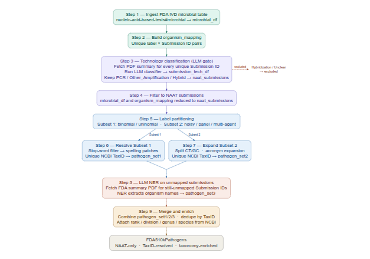

# ampRegistry
Workflow dedicated to building a comprehensive repository of FDA-approved Nucleic Acid Amplification Tests (NAATs).

**Building that mapping required synthesizing three distinct layers of knowledge: (i) clinical diagnostics; (ii) pathogen nomenclature, and (iii) bioinformatic search patterns**.  
**The objective was to bridge the gap between "FDA regulatory labels" and approved organism taxonomic names.**   
The map was built using the following data normalization steps applied for creating the pathogen_synonyms map: transformed "Human-Readable Clinical Text" into "Machine-Readable Biological Identifiers."    
**1. Correcting "Double-i" and Spelling Artifacts**    
Many older scientific or medical texts use variations of Latin endings.
Example: Candida kruseii vs. Candida krusei.
Logic: The International Code of Nomenclature for algae, fungi, and plants (ICN) standardized many of these names. Most sequence databases (NCBI) use the single "i" version. The script identifies the “typos” and mapped the entries to the current taxonomic standard.
**2. Resolving Clinical Shorthand**  
Medical professionals and the FDA often use acronyms that don't exist in a genome database.
Example: Strep A, GBS, CT/GC.
Logic:
Strep A (Group A Streptococcus) is almost exclusively Streptococcus pyogenes.
GBS (Group B Streptococcus) is Streptococcus agalactiae.  
CT/GC are standard clinical abbreviations for Chlamydia trachomatis and Neisseria gonorrhoeae.  
These acronyms were mapped by identifying the "Indications for Use" typically associated with those abbreviations in FDA 510(k) summaries.  
**3. Mapping Product-to-Host (Functional Mapping)**  
Some FDA entries describe the target of the test rather than the organism itself.  
Example: Shiga Toxin.  
Logic: Shiga toxin is a protein produced primarily by STEC (Shiga toxin-producing Escherichia coli) and Shigella dysenteriae. To run an inclusivity check, a primer to a toxin name must be aligned to the genes (stx1 or stx2) within the host genome. Genes mapped this to E. coli as the most common primary diagnostic target.  
**4. Handling Taxonomic "Collapse"**  
The FDA often approves tests for a whole genus or "group," while bioinformatics requires a specific sequence.  
Example: Leishmania species or Mycobacterium species.  
Logic: the "species" or "group" suffix is stripped. In NCBI, searching for the Genus name (Leishmania) is the correct way to retrieve all relevant species for an inclusivity audit.  

## Data source:  
The FDA https://www.fda.gov/medical-devices/in-vitro-diagnostics/nucleic-acid-based-tests#microbial which reports approved NAATs applied to detect pathogens.  
The data features 4 attributes: Microorganism, Trade Name, Manufacturer and a Submission ID.    
## Workflow:  
###   Step 1  - Ingest FDA IVD microbial table → microbial_df  
###   Step 2  - Build organism_mapping (unique label × Submission ID)  
###   Step 3  - Fetch PDF summary for every unique Submission ID  
 - Run LLM technology classifier → submission_tech_df    
 - Filter: select NAAT (amplification-based) submissions only → naat_submissions  
###   Step 4  - Filter microbial_df and organism_mapping to naat_submissions  
###   Step 5  - Split labels into "binomial/uninomial" candidates (Subset 1) vs. noisy /multi-agent / panel labels (Subset 2). 
###   Step 6  - Resolve Subset 1 labels to a unique NCBI Taxonomy ID -> pathogen_set1.  
###   Step 7  - Expand Subset 2 multi-agent labels (e.g. "CT/GC"), apply acronym expansion, and resolve to NCBI Taxonomy IDs -> pathogen_set2.   
###   Step 8  - For 510(k) submissions still unmapped, fetch the FDA summary PDF and use an LLM (NER) to extract organism names -> pathogen_set3.  
###   Step 9  - Merge all three sets, dedupe by TaxID, and attach taxonomic metadata (rank, division, genus, species, ...) from NCBI -> FDA510kPathogens.  

  

